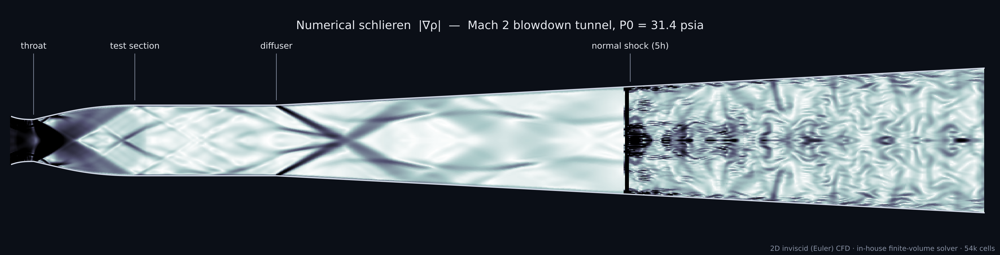
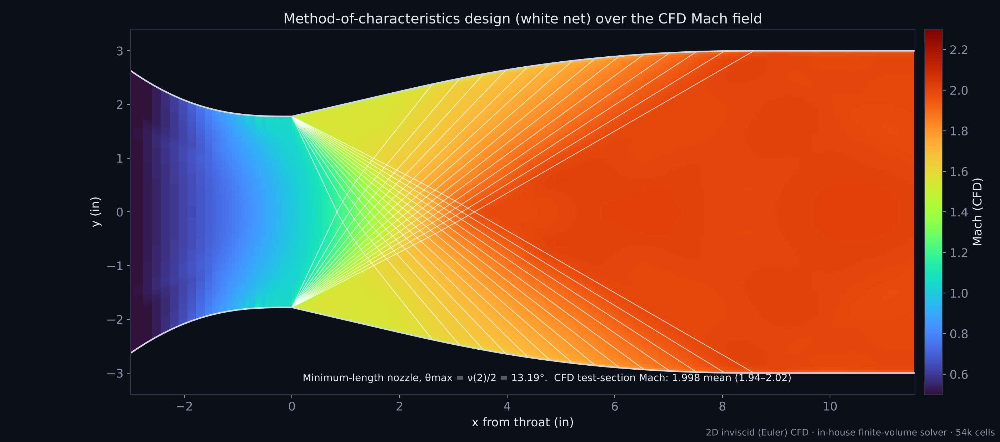
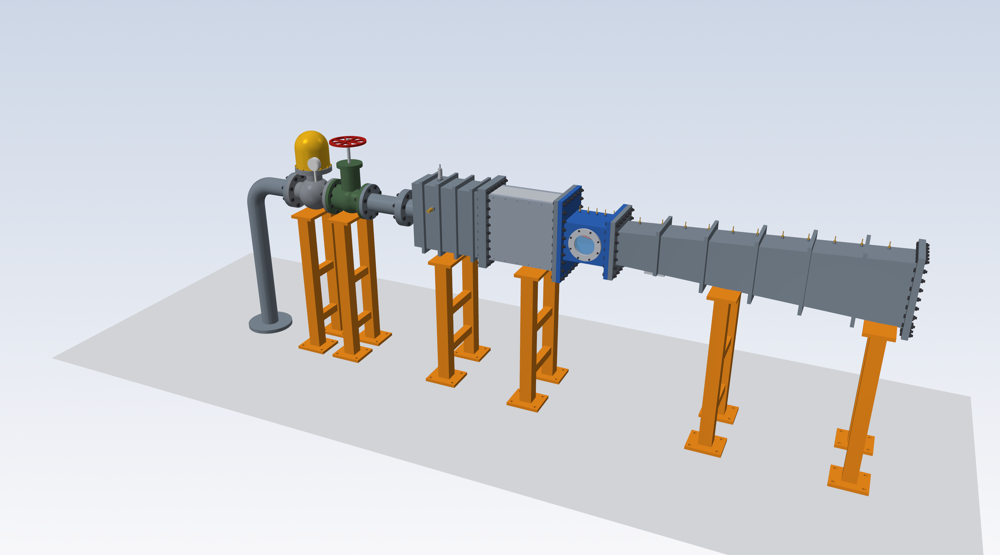
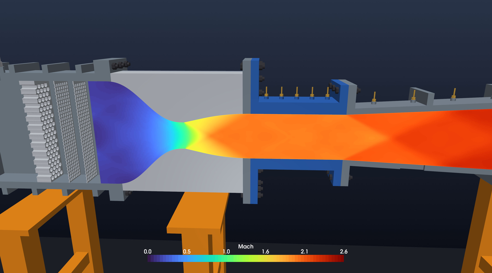
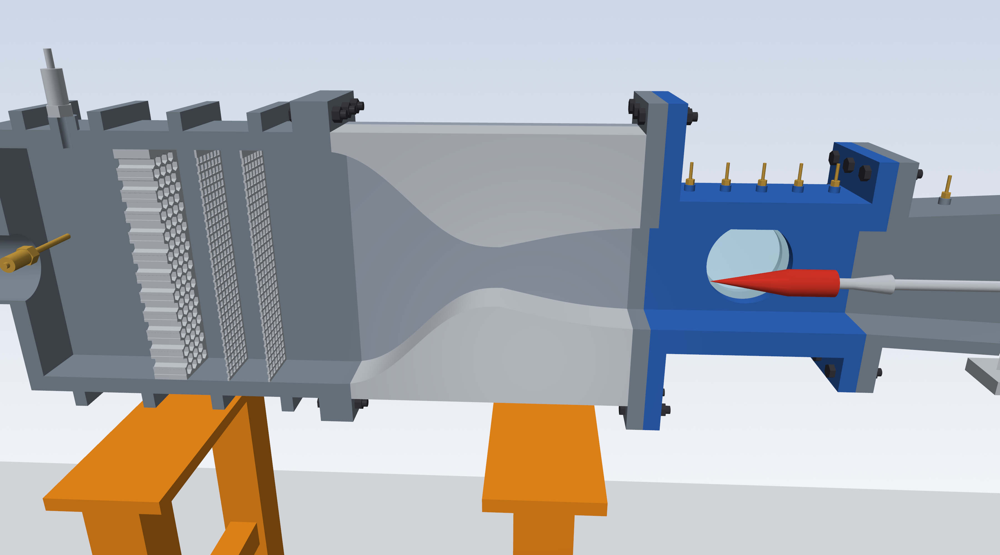

# Mach 2 Blowdown Wind Tunnel: Design, CAD and CFD

Preliminary design of a supersonic blowdown wind tunnel with a 6 x 6 in, Mach 2 test section, taken from
compressible-flow theory through a detailed SolidWorks assembly to a 2D compressible CFD check.


## What's here
| | |
|---|---|
| **Gas dynamics** | Isentropic nozzle sizing, normal-shock diffuser analysis, quasi-1D shock-position model |
| **Nozzle design** | Planar minimum-length nozzle by the method of characteristics (40 characteristics, θmax = 13.19°) |
| **CAD** | 50-part SolidWorks assembly (`cad/`): supply line with regulator and gate valve, plenum with honeycomb and screens, MOC contour blocks, schlieren test section with a cone model on a sting, 3° diffuser with a shock-locating pressure-tap row, support stands, every flange bolt |
| **CFD** | In-house 2D finite-volume Euler solver (`src/euler2d.py`): HLLC flux, MUSCL reconstruction, SSP-RK3, local time stepping, numba-parallel |

## Results



| Check | Theory | 2D CFD |
|---|---|---|
| Test-section Mach | 2.000 | 1.998 mean (1.94 to 2.02 across the section) |
| Mass flow | choked-throat value | 99.8 % of it |
| Normal-shock position at P0 = 31.4 psia | 30.0 in into diffuser (quasi-1D) | 29.7 in |
| Normal-shock position at P0 = 28.8 psia | 22.8 in (quasi-1D) | 22.1 in |

**Finding:** the textbook criterion for holding the shock at a set station (stagnation pressure behind the
shock = atmospheric) assumes the diffuser brings the flow fully to rest. With a real 60 in diffuser the exit is
still at about Mach 0.33, so the tunnel needs about 9 % more stagnation pressure to hold the shock at five
test-section heights downstream. Both the quasi-1D model and the 2D CFD show this.




## Honest limits
- The CFD is **2D planar and inviscid (Euler)** in the **empty tunnel** (no model). It has no boundary layers,
  so it can't show shock trains or shock/boundary-layer separation, which raise the real P0 requirement.
- The shock sweep is a series of converged steady solutions at increasing P0 (28 to 34 psia), not a time-accurate start-up run.
  Below about 28 psia the shock sits within about 3h of the diffuser entry and keeps oscillating by about 0.4h in this solver, so those states are left out.
- In the subsonic diffuser the pattern behind the shock is residual acoustic waves from local time stepping,
  not turbulence. The shock position stays fixed to within one cell (checked over 9,000 extra iterations).
- Grid: 900 x 60 cells on the upper half (symmetry plane at the centreline).

## Run it
```bash
pip install -r requirements.txt
python src/run_cfd.py 31.43 900 60 40000 shock5h    # ~7 min on 4 cores
python src/run_cfd.py 28.83 900 60 40000 design
python src/post_cfd.py shock5h design               # standard plots
python src/flow_visuals.py                          # schlieren, streamlines, MOC overlay, pressure
python src/p0_sweep.py && python src/reconverge.py && python src/shock_sweep_anim.py
python src/import_assembly.py && python src/render_assembly.py   # renders of the SolidWorks assembly
```
`src/tunnel_geometry.py` holds every design parameter (test-section size, Mach, diffuser angle, P0) and the MOC
nozzle. `src/build_portfolio_cad.py` generates a CadQuery version of the assembly from those parameters.
Outputs go to `output/` (not tracked).

## Gallery
| | |
|---|---|
|  |  |
|  |  |
