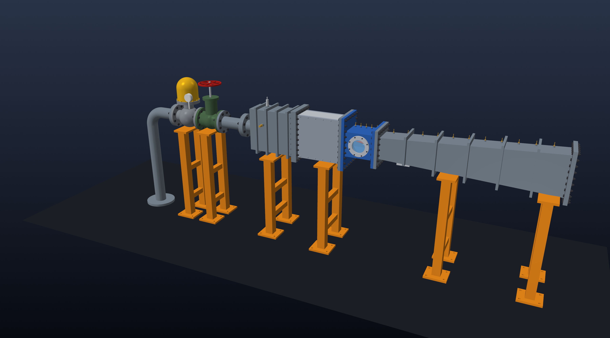
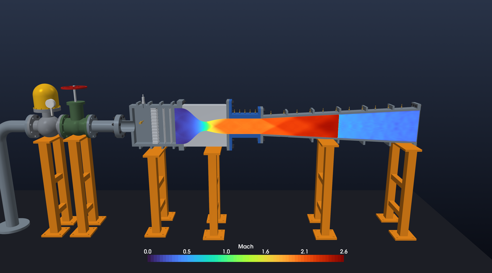
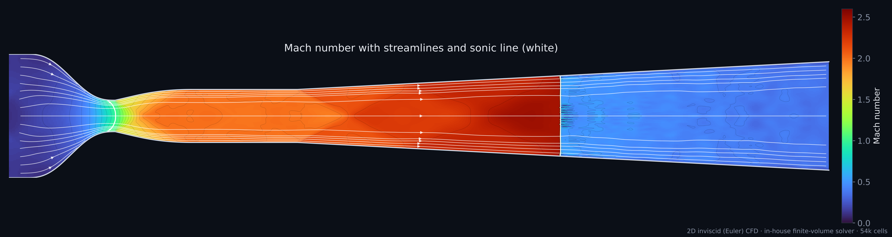
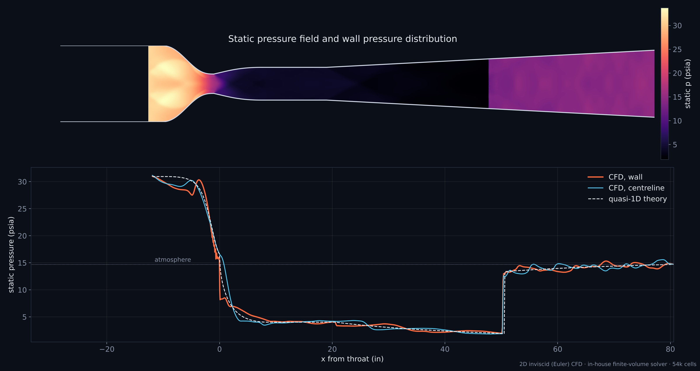
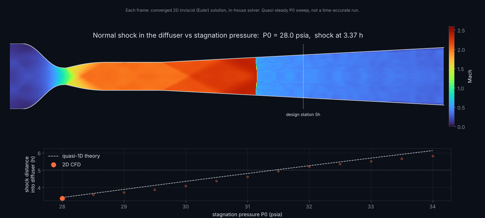
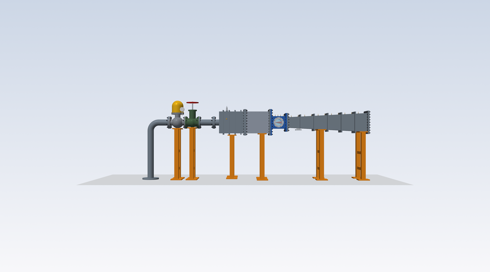
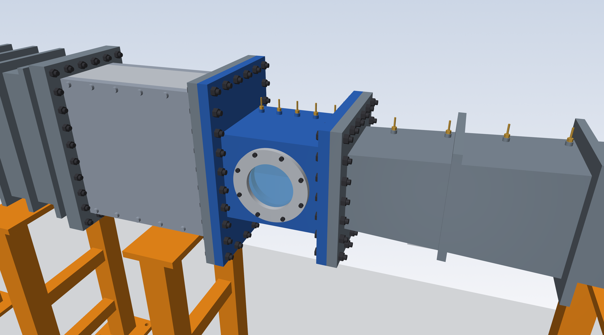
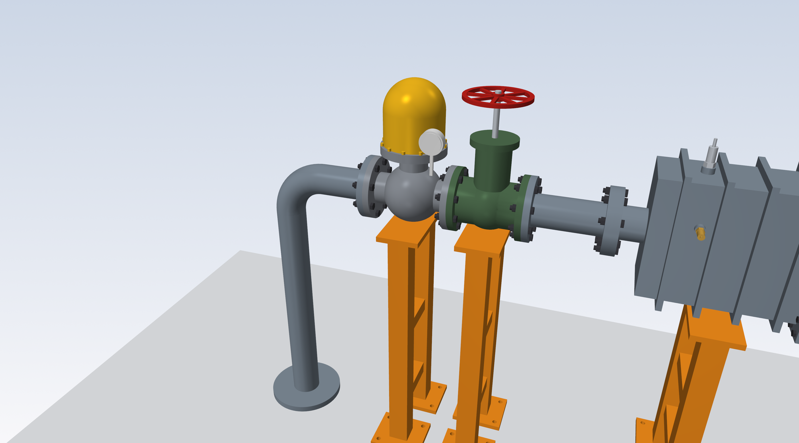

<div align="center">

# Supersonic Wind Tunnel Design, CAD, and CFD
### Design, CAD and CFD of a 6 × 6 in supersonic test facility




</div>

Preliminary design of a supersonic blowdown wind tunnel with a **6 × 6 in, Mach 2 test section**. The design
goes from compressible-flow theory to a detailed 50-part SolidWorks assembly, then to a 2D compressible CFD check
using a finite-volume Euler solver I wrote for this project.



---

## At a glance

| Parameter | Value |
|---|---|
| Test section | 6 in × 6 in, length 2h, Mach 2.0 |
| Nozzle | Planar minimum-length MOC contour, 40 characteristics, θ<sub>max</sub> = 13.19° |
| Settling chamber | 14 in tall plenum with honeycomb straightener and two turbulence screens |
| Diffuser | 3° half-angle per wall, 10h (60 in) long, row of shock-locating pressure taps |
| Design stagnation pressure | 28.8 psia (p<sub>02</sub> = p<sub>atm</sub> criterion); 31.4 psia to hold the shock at 5h |
| CAD | 50-part SolidWorks assembly, exported as STEP |
| CFD | 2D planar Euler, 900 × 60 cells (upper half, symmetry at centreline) |

## Design workflow

```
 Gas dynamics          Nozzle design         CAD                    CFD                  Post-processing
 ──────────────        ─────────────        ─────────────          ──────────────       ────────────────
 Isentropic sizing  →  Method of        →   SolidWorks        →    2D Euler solver  →   Schlieren, Mach,
 Normal-shock          characteristics      assembly (50           HLLC + MUSCL +       MOC overlay,
 diffuser analysis     min-length nozzle    parts) + CadQuery      SSP-RK3              shock sweep,
 Quasi-1D shock model                       parametric model                            assembly renders
```

| | |
|---|---|
| **Gas dynamics** | Isentropic nozzle sizing, normal-shock diffuser analysis, quasi-1D shock-position model |
| **Nozzle design** | Planar minimum-length nozzle by the method of characteristics (40 characteristics, θ<sub>max</sub> = 13.19°) |
| **CAD** | 50-part SolidWorks assembly (`cad/`): supply line with regulator and gate valve, plenum with honeycomb and screens, MOC contour blocks, schlieren test section with a cone model on a sting, 3° diffuser with a shock-locating pressure-tap row, support stands, every flange bolt |
| **CFD** | In-house 2D finite-volume Euler solver (`src/euler2d.py`): HLLC flux, MUSCL reconstruction, SSP-RK3, local time stepping, numba-parallel |

---

## Results




| Check | Theory | 2D CFD |
|---|---|---|
| Test-section Mach | 2.000 | 1.998 mean (1.94 to 2.02 across the section) |
| Mass flow | choked-throat value | 99.8 % of it |
| Normal-shock position at P0 = 31.4 psia | 30.0 in into diffuser (quasi-1D) | 29.7 in |
| Normal-shock position at P0 = 28.8 psia | 22.8 in (quasi-1D) | 22.1 in |

> **Key finding:** the textbook criterion for holding the shock at a set station (stagnation pressure behind the
> shock = atmospheric) assumes the diffuser brings the flow fully to rest. With a real 60 in diffuser the exit is
> still at about Mach 0.33, so the tunnel needs about **9 % more stagnation pressure** to hold the shock at five
> test-section heights downstream. Both the quasi-1D model and the 2D CFD show this.

### MOC nozzle vs. CFD
The characteristic net from the method-of-characteristics design, drawn over the CFD Mach field.


### Pressure field and wall pressure


### Shock position vs. stagnation pressure
The normal shock walks down the diffuser as P0 rises from 28 to 34 psia.

<p align="center"></p>

---

## CAD assembly

The full tunnel is modelled part by part, from the storage-tank supply riser to the exhaust debris screen.

| Group | Parts | Examples |
|---|:---:|---|
| Supply line | 9 | Supply riser, pressure regulator with dome loader, isolation gate valve with handwheel, pipe spools |
| Plenum / flow conditioning | 4 | Plenum chamber, honeycomb flow straightener, two turbulence screens |
| Nozzle | 6 | Upper and lower MOC contour blocks, side plates, inlet and exit flanges |
| Test section | 5 | Test-section body, schlieren window glass with retainer rings |
| Model | 3 | 10° cone-cylinder test model, sting, sting support strut |
| Diffuser | 2 | 3° per-wall diffuser, exhaust debris screen |
| Instrumentation | 5 | Plenum pressure transducer, stagnation thermocouple, dome pressure gauge, pressure-tap fittings |
| Stands | 6 | Support stands under the regulator, gate valve, plenum, nozzle and diffuser |
| Fasteners | 10 | Every flange joint and window retainer bolted |

Open `cad/wind_tunnel_assembly.STEP` in SolidWorks, Fusion 360, FreeCAD or any STEP viewer. Part names, colours
and groups are in `cad/parts_metadata.json`.

| | |
|---|---|
|  |  |
|  |  |
|  |  |

---

## Honest limits
- The CFD is **2D planar and inviscid (Euler)** in the **empty tunnel** (no model). It has no boundary layers,
  so it can't show shock trains or shock/boundary-layer separation, which raise the real P0 requirement.
- The shock sweep is a series of converged steady solutions at increasing P0 (28 to 34 psia), not a time-accurate start-up run.
  Below about 28 psia the shock sits within about 3h of the diffuser entry and keeps oscillating by about 0.4h in this solver, so those states are left out.
- In the subsonic diffuser the pattern behind the shock is residual acoustic waves from local time stepping,
  not turbulence. The shock position stays fixed to within one cell (checked over 9,000 extra iterations).
- Grid: 900 x 60 cells on the upper half (symmetry plane at the centreline).

---

## Repository layout

```
mach2-blowdown-tunnel/
├── cad/                         SolidWorks assembly as STEP (50 parts + top-level assembly)
│   ├── wind_tunnel_assembly.STEP
│   └── parts_metadata.json      part names, colours, groups
├── images/
│   ├── cfd/                     schlieren, Mach, MOC overlay, pressure, shock sweep
│   └── renders/                 assembly renders
├── src/
│   ├── tunnel_geometry.py       all design parameters + gas dynamics + MOC nozzle
│   ├── euler2d.py               2D finite-volume Euler solver
│   ├── run_cfd.py               run a case
│   ├── post_cfd.py              standard plots and theory comparison
│   ├── flow_visuals.py          presentation flow visuals
│   ├── p0_sweep.py              quasi-steady P0 sweep
│   ├── reconverge.py            extra iterations for drifting sweep frames
│   ├── shock_sweep_anim.py      shock sweep animation
│   ├── import_assembly.py       STEP → STL for rendering
│   ├── render_assembly.py       VTK renders
│   └── build_portfolio_cad.py   parametric CadQuery version of the assembly
└── requirements.txt
```

## Run it
```bash
pip install -r requirements.txt
python src/run_cfd.py 31.43 900 60 40000 shock5h    # ~7 min on 4 cores
python src/run_cfd.py 28.83 900 60 40000 design
python src/post_cfd.py shock5h design               # standard plots
python src/flow_visuals.py                          # schlieren, streamlines, MOC overlay, pressure
python src/p0_sweep.py && python src/reconverge.py && python src/shock_sweep_anim.py
python src/import_assembly.py && python src/render_assembly.py   # renders of the SolidWorks assembly
```
`src/tunnel_geometry.py` holds every design parameter (test-section size, Mach, diffuser angle, P0) and the MOC
nozzle; change `CASE` to build another configuration. `src/build_portfolio_cad.py` generates a CadQuery version
of the assembly from those parameters. Outputs go to `output/` (not tracked).

---

**Andrew McGuigan** · B.S./M.S. Aerospace Engineering, University of Florida
